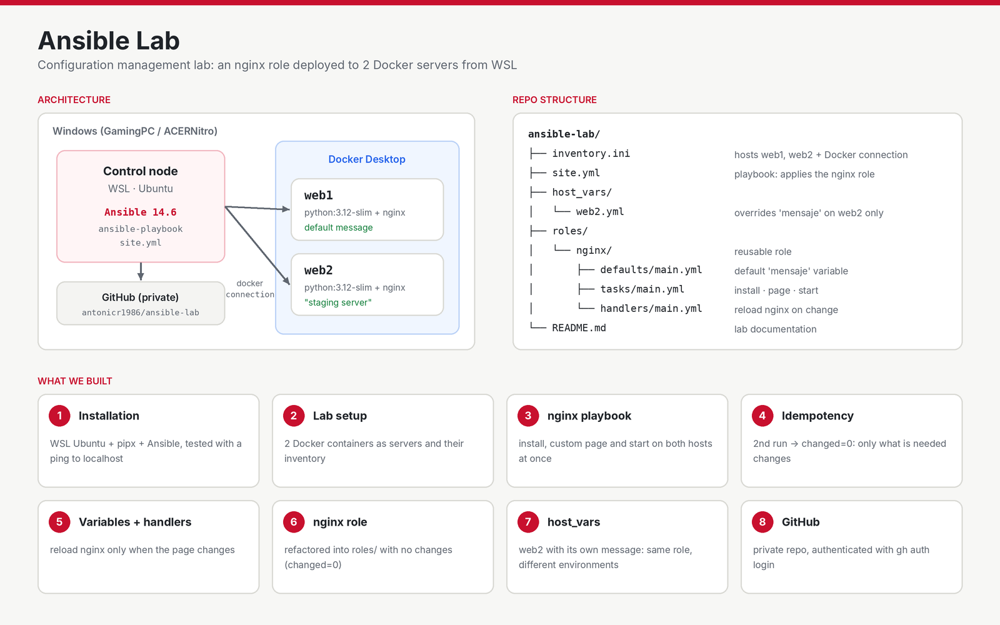

# Ansible Lab

[](https://github.com/antonicr1986/ansible-lab/actions/workflows/ci.yml)

<details open>
<summary><strong>🇬🇧 English</strong></summary>

<br>

Hands-on **configuration management** lab with Ansible. An `nginx` role is deployed from a WSL (Ubuntu) control node to two Docker containers that act as servers, and every push is validated by a CI pipeline.



### What it covers

- **Inventory** with two hosts (`web1`, `web2`) using the Docker connection plugin, no SSH needed
- **`ansible.cfg`** with project defaults (inventory, roles path, YAML output, vault password file)
- **Variables and precedence**: role `defaults` → `group_vars` → `host_vars` → `-e`
- **Reusable `nginx` role**: installs nginx, renders the welcome page from a **Jinja2 template** using facts and makes sure nginx is running
- **Handlers**: nginx is reloaded only when the page actually changes
- **Ansible Vault**: an encrypted secret (`app_token`) stored in the repo and deployed with `no_log: true` and `0600` permissions
- **Idempotency**: a second run reports `changed=0` (checked automatically in CI)
- **Code quality**: `yamllint` + `ansible-lint` passing the `production` profile

### CI pipeline (GitHub Actions)

| Job | What it does |
|---|---|
| `lint` | Runs `yamllint` and `ansible-lint` |
| `deploy-test` | Starts `web1` and `web2`, runs the playbook twice, fails if the second run is not idempotent and checks nginx responds on both hosts |

The vault password is provided to the pipeline as the `ANSIBLE_VAULT_PASSWORD` repository secret.

### Structure

```
ansible-lab/
├── .github/workflows/ci.yml   # CI pipeline
├── ansible.cfg                # project settings
├── .yamllint                  # yamllint rules (compatible with ansible-lint)
├── inventory.ini              # hosts
├── site.yml                   # main playbook
├── group_vars/
│   └── webservers.yml         # connection vars, group message and vaulted secret
├── host_vars/
│   └── web2.yml               # per-host override
├── roles/
│   └── nginx/
│       ├── defaults/main.yml  # default variables
│       ├── tasks/main.yml     # install · template · start · secret
│       ├── handlers/main.yml  # reload nginx
│       └── templates/
│           └── index.html.j2  # welcome page
└── docs/                      # diagrams
```

### Requirements

- Linux or WSL (Ubuntu) with Ansible (`pipx install --include-deps ansible`)
- Docker (Docker Desktop with WSL integration enabled)

### Run it

The vault password is not in the repo. To run it locally, create your own password and replace `app_token` in `group_vars/webservers.yml` with your own encrypted value:

```bash
echo 'your-password' > .vault_pass && chmod 600 .vault_pass
ansible-vault encrypt_string 'your-token' --name 'app_token'
```

Then:

```bash
docker run -d --name web1 python:3.12-slim sleep infinity
docker run -d --name web2 python:3.12-slim sleep infinity

ansible webservers -m ping
ansible-playbook site.yml

docker exec web1 curl -s localhost
docker exec web2 curl -s localhost
```

Expected output:

```
Hola desde web1. Mensaje del grupo webservers
Sistema: Debian 13.x
Hola desde web2. Soy el servidor de staging
Sistema: Debian 13.x
```

`web1` takes its message from `group_vars` and `web2` from `host_vars`, which has higher precedence.

### Lint

```bash
yamllint .
ansible-lint
```

### Clean up

```bash
docker rm -f web1 web2
```

</details>

<details>
<summary><strong>🇪🇸 Español</strong></summary>

<br>

Laboratorio práctico de **gestión de configuración** con Ansible. Se despliega un rol `nginx` desde un nodo de control en WSL (Ubuntu) a dos contenedores Docker que hacen de servidores, y cada push se valida con un pipeline de CI.


### Qué incluye

- **Inventario** con dos hosts (`web1`, `web2`) usando el plugin de conexión Docker, sin necesidad de SSH
- **`ansible.cfg`** con la configuración del proyecto (inventario, ruta de roles, salida en YAML, fichero de contraseña del vault)
- **Variables y prioridad**: `defaults` del rol → `group_vars` → `host_vars` → `-e`
- **Rol `nginx` reutilizable**: instala nginx, genera la página de bienvenida con una **plantilla Jinja2** que usa facts y se asegura de que nginx esté en marcha
- **Handlers**: nginx solo se recarga cuando la página cambia de verdad
- **Ansible Vault**: un secreto cifrado (`app_token`) guardado en el repo y desplegado con `no_log: true` y permisos `0600`
- **Idempotencia**: una segunda ejecución da `changed=0` (se comprueba automáticamente en el CI)
- **Calidad de código**: `yamllint` + `ansible-lint` superando el perfil `production`

### Pipeline de CI (GitHub Actions)

| Job | Qué hace |
|---|---|
| `lint` | Ejecuta `yamllint` y `ansible-lint` |
| `deploy-test` | Levanta `web1` y `web2`, ejecuta el playbook dos veces, falla si la segunda ejecución no es idempotente y comprueba que nginx responde en los dos hosts |

La contraseña del vault llega al pipeline mediante el secret del repositorio `ANSIBLE_VAULT_PASSWORD`.

### Estructura

```
ansible-lab/
├── .github/workflows/ci.yml   # pipeline de CI
├── ansible.cfg                # configuración del proyecto
├── .yamllint                  # reglas de yamllint (compatibles con ansible-lint)
├── inventory.ini              # hosts
├── site.yml                   # playbook principal
├── group_vars/
│   └── webservers.yml         # conexión, mensaje del grupo y secreto cifrado
├── host_vars/
│   └── web2.yml               # variables propias de web2
├── roles/
│   └── nginx/
│       ├── defaults/main.yml  # variables por defecto
│       ├── tasks/main.yml     # instalar · plantilla · arrancar · secreto
│       ├── handlers/main.yml  # recargar nginx
│       └── templates/
│           └── index.html.j2  # página de bienvenida
└── docs/                      # diagramas
```

### Requisitos

- Linux o WSL (Ubuntu) con Ansible (`pipx install --include-deps ansible`)
- Docker (Docker Desktop con la integración WSL activada)

### Cómo ejecutarlo

La contraseña del vault no está en el repo. Para ejecutarlo en local, crea tu propia contraseña y sustituye `app_token` en `group_vars/webservers.yml` por tu propio valor cifrado:

```bash
echo 'tu-contraseña' > .vault_pass && chmod 600 .vault_pass
ansible-vault encrypt_string 'tu-token' --name 'app_token'
```

Después:

```bash
docker run -d --name web1 python:3.12-slim sleep infinity
docker run -d --name web2 python:3.12-slim sleep infinity

ansible webservers -m ping
ansible-playbook site.yml

docker exec web1 curl -s localhost
docker exec web2 curl -s localhost
```

Resultado esperado:

```
Hola desde web1. Mensaje del grupo webservers
Sistema: Debian 13.x
Hola desde web2. Soy el servidor de staging
Sistema: Debian 13.x
```

`web1` toma el mensaje de `group_vars` y `web2` de `host_vars`, que tiene más prioridad.

### Lint

```bash
yamllint .
ansible-lint
```

### Limpiar

```bash
docker rm -f web1 web2
```

</details>
