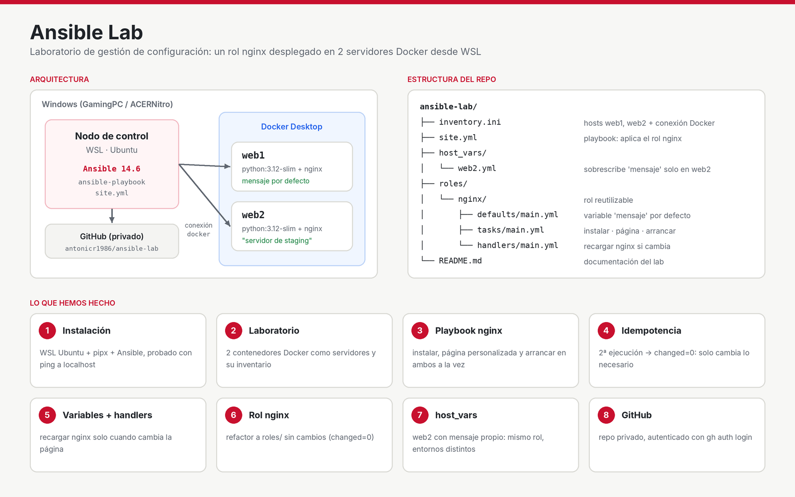

# Ansible Lab

<details open>
<summary><strong>🇬🇧 English</strong></summary>

<br>

Hands-on **configuration management** lab with Ansible. An `nginx` role is deployed from a WSL (Ubuntu) control node to two Docker containers that act as servers.


### What it covers

- **Inventory** with two hosts (`web1`, `web2`) using the Docker connection plugin, no SSH needed
- **Reusable `nginx` role**: installs nginx, deploys a custom welcome page and starts the service
- **Handlers**: nginx is reloaded only when the page actually changes
- **Variables**: role defaults overridden per host with `host_vars` (e.g. a different message on `web2`)
- **Idempotency**: running the playbook again reports `changed=0`

### Structure

```
ansible-lab/
├── inventory.ini              # hosts + Docker connection
├── site.yml                   # main playbook (applies the nginx role)
├── host_vars/
│   └── web2.yml               # per-host override
├── roles/
│   └── nginx/
│       ├── defaults/main.yml  # default variables
│       ├── tasks/main.yml     # install · page · start
│       └── handlers/main.yml  # reload nginx
└── docs/                      # diagrams
```

### Requirements

- Linux or WSL (Ubuntu) with Ansible (`pipx install --include-deps ansible`)
- Docker (Docker Desktop with WSL integration enabled)

### Run it

```bash
docker run -d --name web1 python:3.12-slim sleep infinity
docker run -d --name web2 python:3.12-slim sleep infinity

ansible webservers -i inventory.ini -m ping
ansible-playbook -i inventory.ini site.yml

docker exec web1 curl -s localhost
docker exec web2 curl -s localhost
```

Expected output:

```
Hola desde web1. Versión 2, desplegada con Ansible
Hola desde web2. Soy el servidor de staging
```

### Clean up

```bash
docker rm -f web1 web2
```

</details>

<details>
<summary><strong>🇪🇸 Español</strong></summary>

<br>

Laboratorio práctico de **gestión de configuración** con Ansible. Se despliega un rol `nginx` desde un nodo de control en WSL (Ubuntu) a dos contenedores Docker que hacen de servidores.



### Qué incluye

- **Inventario** con dos hosts (`web1`, `web2`) usando el plugin de conexión Docker, sin necesidad de SSH
- **Rol `nginx` reutilizable**: instala nginx, despliega una página de bienvenida personalizada y arranca el servicio
- **Handlers**: nginx solo se recarga cuando la página cambia de verdad
- **Variables**: valores por defecto del rol sobrescritos por servidor con `host_vars` (por ejemplo, otro mensaje en `web2`)
- **Idempotencia**: si vuelves a ejecutar el playbook, el resultado es `changed=0`

### Estructura

```
ansible-lab/
├── inventory.ini              # hosts + conexión Docker
├── site.yml                   # playbook principal (aplica el rol nginx)
├── host_vars/
│   └── web2.yml               # variables propias de web2
├── roles/
│   └── nginx/
│       ├── defaults/main.yml  # variables por defecto
│       ├── tasks/main.yml     # instalar · página · arrancar
│       └── handlers/main.yml  # recargar nginx
└── docs/                      # diagramas
```

### Requisitos

- Linux o WSL (Ubuntu) con Ansible (`pipx install --include-deps ansible`)
- Docker (Docker Desktop con la integración WSL activada)

### Cómo ejecutarlo

```bash
docker run -d --name web1 python:3.12-slim sleep infinity
docker run -d --name web2 python:3.12-slim sleep infinity

ansible webservers -i inventory.ini -m ping
ansible-playbook -i inventory.ini site.yml

docker exec web1 curl -s localhost
docker exec web2 curl -s localhost
```

Resultado esperado:

```
Hola desde web1. Versión 2, desplegada con Ansible
Hola desde web2. Soy el servidor de staging
```

### Limpiar

```bash
docker rm -f web1 web2
```

</details>
